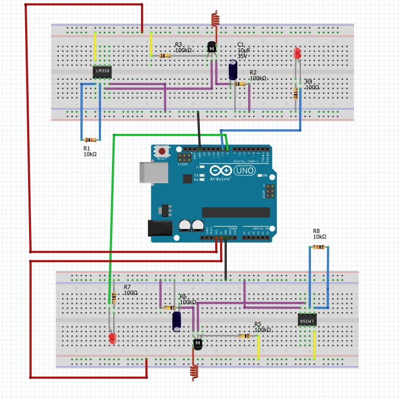
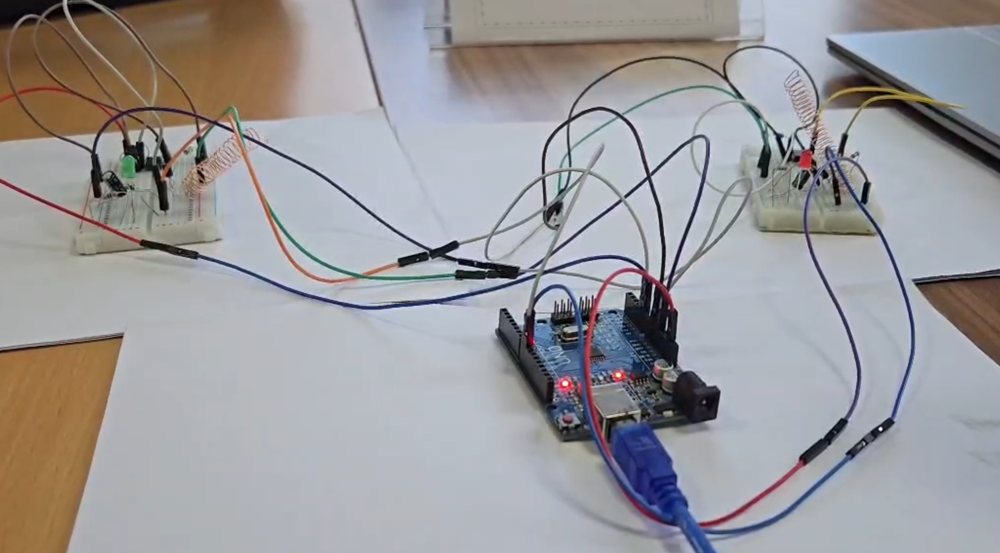
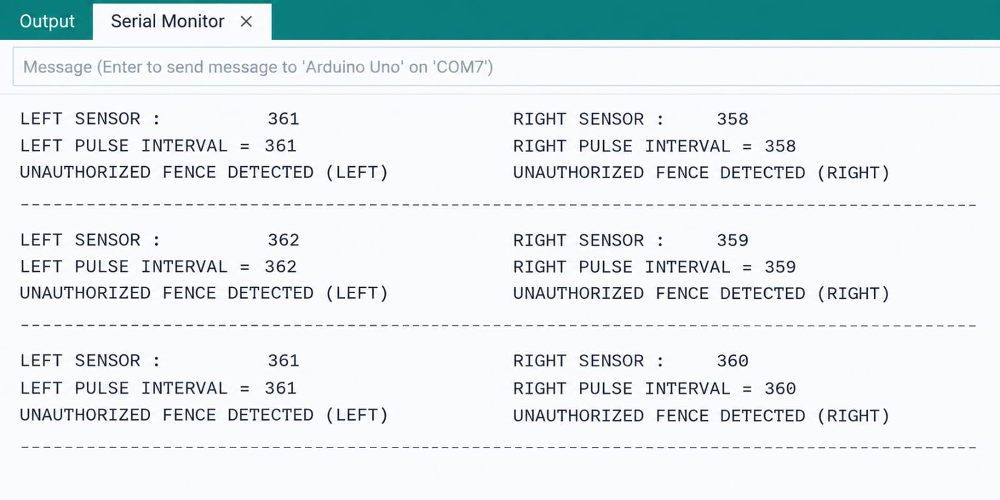

# Unauthorized Electric Fence Detection System

**Project Period:** 2025  
**Achievement:** Smart India Hackathon 2025 Finalist

## Project Overview

A hardware prototype developed to detect unauthorized electric fences by sensing the electromagnetic field generated around an energized fence.

The system uses a dual-copper-coil sensing arrangement to detect electric-field fluctuations and analyze the pulse interval and frequency of the detected signal. When the detected fence falls outside the specified safety range, the system identifies it as unauthorized and provides a visual indication through LEDs.

## Technical Approach

The prototype follows this signal-processing chain:

**Electric Fence AC Field → Copper Coil Antenna → Signal Coupling → JFET Signal Pickup → LM358 Amplification → Arduino → Fence Detection → LED Indication**

The dual-antenna arrangement allows simultaneous sensing from two sides and was designed to help distinguish nearby fences.

## Hardware

- Arduino Uno
- Dual copper-coil antenna sensors
- JFET BF245A
- LM358 operational amplifier
- RC filtering components
- LEDs
- Resistors and capacitors
- Battery / power supply
- Breadboards and jumper connections

## Working Principle

1. The copper-coil antennas sense the electromagnetic field generated by an energized electric fence.
2. The sensed signal is coupled into the analog signal-conditioning stage.
3. A JFET provides the initial high-impedance signal pickup.
4. The LM358 amplifies the detected signal.
5. The amplified signal is provided to the Arduino for analysis.
6. The pulse interval and corresponding frequency are evaluated against the specified safety range.
7. When an unauthorized fence is detected, the corresponding LED provides a visual indication.

## Circuit Diagram

## Physical Prototype

## Detection Demonstration

The Arduino Serial Monitor was used during testing to observe the measured pulse interval and fence-detection decision.

Example observed output:

`LEFT PULSE INTERVAL = 361`

`UNAUTHORIZED FENCE DETECTED (LEFT)`

`RIGHT PULSE INTERVAL = 358`

`UNAUTHORIZED FENCE DETECTED (RIGHT)`

## Software

- Arduino IDE
- Embedded C/C++
- Arduino Uno

## Project Documentation

The project documentation is included in the `docs` folder.

## Project Significance

The prototype was developed as part of Smart India Hackathon 2025 and reached the finals.

It demonstrates an embedded hardware approach for non-contact detection of potentially unauthorized electric fencing using electromagnetic sensing, analog signal conditioning and microcontroller-based decision making.

## Project Structure

SIH2025-Electric-Fence-Detector/

├── README.md  
├── docs/  
│   └── SIH2025-documentation.docx  
├── images/  
│   ├── circuit-diagram.png  
│   ├── hardware-prototype.jpg  
│   └── detection-result.png  
└── src/

## Note

This repository documents the prototype developed for Smart India Hackathon 2025. The documented prototype is intended as a project demonstration and is not presented as a certified electrical safety device.